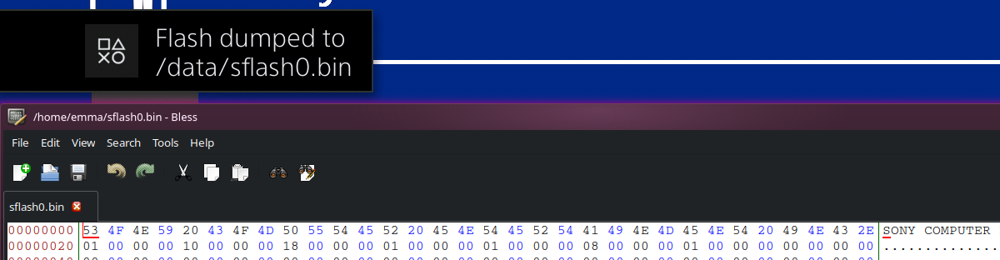
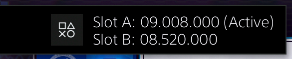

# misc-ps4-payloads

Some miscellaneous PS4 payloads I've made. They may or may not be useful to you.

Built with the [Scene Collective ps4-payload-sdk](https://github.com/Scene-Collective/ps4-payload-sdk).

> [!WARNING]
> These payloads are provided with absolutely **NO WARRANTY**. I am not
> responsible if the payloads themselves or the results from the payload cause
> problems with or damage to your PS4, or any data on it.
>
> **You are responsible for your own console.**

## hdcp-disable

Disables HDCP output from your PS4. Useful for running after BD-JB or
VueAfterFree (where those applications require HDCP enabled to launch) if you
want to use a capture card.

## sflash-dumper

Dumps the serial flash / NOR of the console to the /data/ folder on the hard
drive. (TODO: dump to USB)

It also dumps a decrypted copy of the encrypted sflash0s1 segment.

## slot-versions

Displays the exact system version contained in both update "slots" of your
console's flash. Useful if you want to know what exact version you would be
able to downgrade to using the
[Firmware Revert Hack](https://consolemods.org/wiki/PS4:Firmware_Revert).

## License

This project is licensed under the MIT License - see
[LICENSE.txt](./LICENSE.txt).
